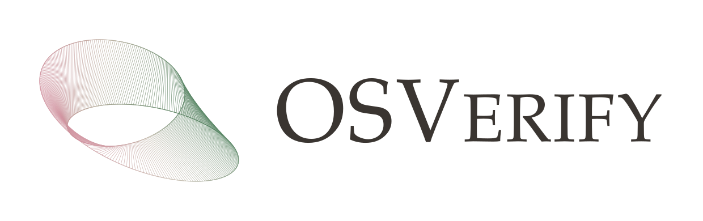

  <picture>
    <source media="(prefers-color-scheme: dark)" srcset="assets/osverify-dark.svg">
    
  </picture>

<b>One-sided verification under limited expert review</b>

AI systems can now propose candidate solutions to open scientific problems far faster than human experts can review them. **OSVerify** filters out invalid candidates while keeping the false-rejection rate of valid solutions under a fixed budget, so that expert time is spent on the candidates most likely to be correct.

It decouples **error proposal** — searching for errors at different granularities via hierarchical decomposition — from **error validation**, which separates substantial errors from minor or hallucinated ones.

Paper and code coming soon.
